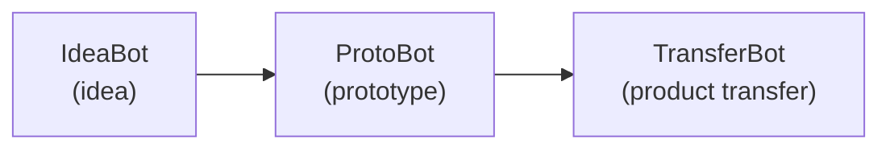

# ProtoBot

ProtoBot is an experimental, spec-first software development system. It
takes structured requirements and generates working, tested, inspected
prototypes for customer demonstrations. It is the second tool in the Hermes
pipeline:



ProtoBot is intended to produce prototypes, not final production products.
The implementation is a disposable, regenerable artifact. The durable asset
is the specification and the evidence showing how a particular implementation
conformed to it.

## Approach to Software Development

ProtoBot puts human judgment before implementation and automation after the
specification is approved:

1. **Sketching:** A person and an agent define the project's Vision and
   Architecture, including its observable external interfaces.
2. **Dimensioning:** They turn those interfaces into precise EARS
   (Easy Approach to Requirements Syntax) requirements. This approved
   Schematic is the human review boundary.
3. **Building:** Autonomous Workers independently generate tests and
   implementation from the approved requirements. The test Worker cannot see
   implementation source, and the implementation Worker cannot see canonical
   test source.
4. **Inspecting:** Independent Inspectors review the result for security,
   test completeness, code quality, specification conformance, and mutation
   survivors. Defects return to Building; undefined behavior blocks the work
   until the specification is clarified.

The core principles are:

- **The specification is the source.** People define what the system must do;
  agents determine how to implement it. Code and tests can be regenerated from
  the approved specification.
- **Observable behavior comes first.** Requirements describe stable external
  behavior and interfaces, not internal modules or implementation choices.
- **Verification must be independent.** Separating test and code generation
  helps prevent agents from optimizing for a visible oracle instead of the
  intended behavior.
- **Constraints are structural.** Sandboxes, repository projections, tooling,
  and policy enforce isolation and permissions rather than relying on prompts
  or agent discipline alone.
- **Every component must be evaluable.** A known input and measurable output
  are prerequisites for improving an agent, tool, or workflow stage.

At the system level, the Drafting Table hosts interactive specification work,
the V2 specification validator checks `spec/` against the approved baseline,
the Job Site runs autonomous Building and Inspecting, and a pluggable WMS
Adapter tracks work-item lifecycle. Project content remains in Git; workflow
state and commit-scoped conformance evidence are recorded separately.

## Repository Layout

ProtoBot is a language-agnostic monorepo. Each independently buildable
component owns its native module and toolchain. The current Go components are
organized as:

```text
drafting-table/
  go.mod
  cmd/drafting-table-guard/ # shared harness guard
  guard.go, shell.go, ...   # tool policy, path checks, and shell validation
  testdata/                 # guard security vectors
source-control-manager/
  go.mod
  cmd/source-control-manager/
  internal/{cli,mcpserver,scm,gitx,host,ears,render,...}/
  internal/golden/          # the golden repository fixture, replayed
  internal/testing/         # the gh and ears-manager stubs of the fixture
  internal/jobsite/         # Worker projection isolation and sandbox contract (#78, #79)
validator/
  go.mod
  cmd/validator/            # V2 specification validator CLI
  internal/cli/             # checkout path and comparison-base arguments
  internal/ears/            # EARS shape and single-shall validation
  internal/gitcmd/          # managed Git child process execution
  internal/immutability/    # parsed requirement text immutability check
  internal/layout/          # spec/requirements and spec/interfaces reader
  internal/records/         # V2 requirement and interface structures
  internal/revision/        # Git revision reader for comparison-base records
  internal/specvalidation/  # record schema, identifier checks, relationship types, and reference resolution
  internal/testtags/        # Gherkin @req:<ID> tag reference resolution
wms/
  go.mod
  adapter/                  # backend-neutral wire types and operation surfaces
  validation/               # backend-neutral lifecycle evaluator
  memory/                   # in-memory WMS conformance adapter
  github/                   # GitHub Issues backend translator (#68)
```

Additional WMS backends can use their native layout under the same monorepo,
for example `wms/jira/`; other components can use a native
layout such as `drafting-table/web/`. The root `go.work` makes local Go
component development convenient without coupling other languages to Go.

The install targets are:

```text
go install github.com/redhat-et/protobot/source-control-manager/cmd/source-control-manager@latest
go install github.com/redhat-et/protobot/drafting-table/cmd/drafting-table-guard@latest
go install github.com/redhat-et/protobot/validator/cmd/validator@latest
```

Run the Drafting Table guard's local Go checks from its module:

```sh
cd drafting-table
go test ./...
go vet ./...
```

Run these maintenance checks from a terminal or unguarded development
session. In a guarded other-role shell session, code-executing runners
such as `go test` are refused because the guard cannot inspect test code
for indirect governed writes.

### Drafting Table OpenCode binding

The OpenCode binding (`.opencode/`, the shared
`.agents/drafting-table.yaml` manifest, and the `drafting-specifications`
session skill) targets OpenCode v2 (designed against OpenCode 2.0.28).
Root `opencode.json` disables session sharing only; it does not start MCP
servers or deny file edits. The headless replay command exercises the
historical #77 baseline driver pinned to OpenCode 1.18.30 until #77 re-runs
it on v2. Removal R1 (#406) deleted the `ears-manager` module that driver
builds, so the replay is not runnable until #428 reworks the Drafting Table
wiring:

```sh
PYTHONDONTWRITEBYTECODE=1 OPENCODE_BIN=/path/to/opencode-1.18.30/bin/opencode \
  python -m unittest discover -s tests/drafting-table -p 'test_*.py' -v
```

## Specification store

Specifications are plain files in Git. Requirement records live under
`spec/requirements/` and interface records under `spec/interfaces/`; both are
committed and reviewed like any other source file. The repository currently
holds the `protobot-cli` interface and requirement `REQ-CLI-00001`.

The V2 specification validator checks the records for schema, identifier
format and uniqueness, relationship types, reference resolution,
`depends-on` and `supersedes` acyclicity, EARS shape, test `@req:<ID>` tag
references, and parsed-text immutability against a comparison base. It is
deterministic, network-free, and reads only the checkout. Run it from the
repository root:

```sh
python3 scripts/check_spec_validator.py
```

The script selects the comparison base, builds the validator from
`validator/` with module downloads disabled, and fails the run on any
diagnostic. It is also the `spec-validator` pre-commit hook, and
pull-request and default-branch CI run the same validator, so local and CI
results match. A pull request can change its own validator or workflow, so
human review and protected checks remain the trust boundary.

## Documentation

- [ProtoBot project board](https://github.com/orgs/redhat-et/projects/35/views/1)
- [Vision](docs/vision.md)
- [Architecture overview](docs/architecture/overview.md)
- [Architecture interfaces and constraints](docs/architecture.md)
- [Source Control Manager](docs/architecture/source-control-manager.md)
- [System components](docs/architecture/components.md)
- [User interaction flow](docs/architecture/user-interaction-flow.md)
- [Related work](docs/architecture/related-work.md)
- [Open design questions](docs/architecture/open-questions.md)
- [Architecture decisions](docs/decisions/)
- [Evaluation corpus schema and result contract](docs/architecture/evaluation-corpus.md)

ProtoBot is under active design and implementation. The architecture documents
describe the current direction and identify decisions that remain open.

## License

ProtoBot is licensed under the [Apache License 2.0](LICENSE).
